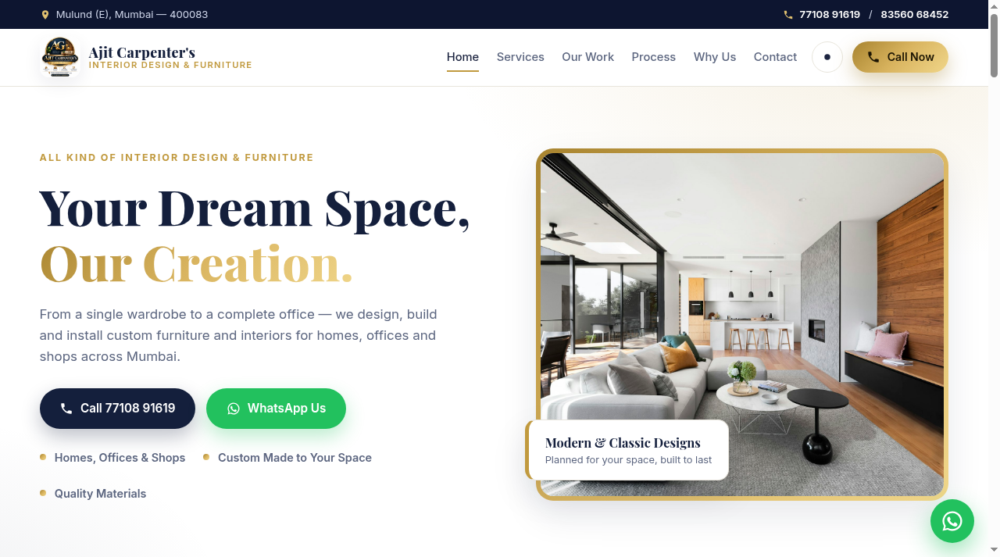
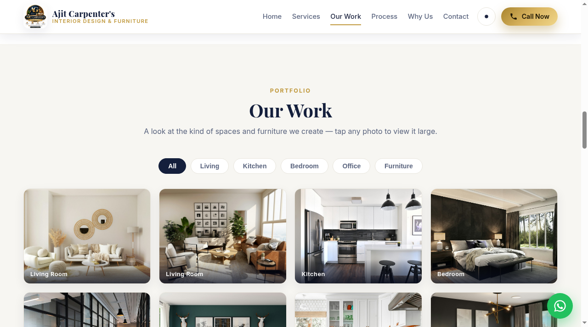
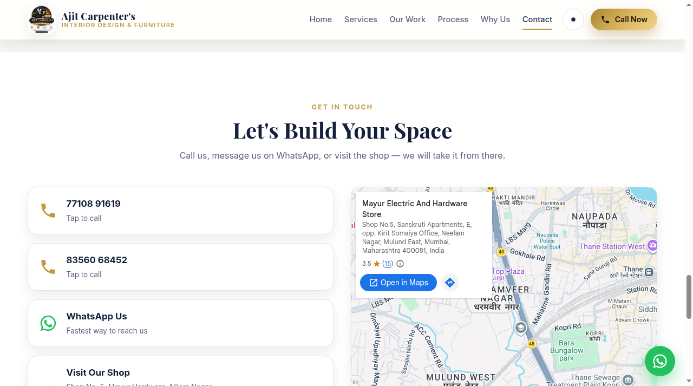

# Ajit Carpenter's — Interior Design & Furniture Website

**Live site: https://ajit-carpenters.pages.dev**

Professional business website for **Ajit Carpenter's** — a carpentry and interior shop in Mulund (E), Mumbai that takes furniture and interior contracts for offices, homes, rooms and shops.

> Your Dream Space, Our Creation...

## What the site includes

- **Premium navy + gold design** matching the shop's brand logo — pure white default theme with a working dark mode toggle
- **Fully responsive** — tested on desktop and mobile (sticky Call / WhatsApp bar on phones)
- **Services** — Home Interior Design, Office Interior, Modular Kitchen, Wardrobes & Storage, Custom Made Furniture, Space Planning & Design
- **Portfolio gallery** — filterable (Living / Kitchen / Bedroom / Office / Furniture) with a full-screen lightbox
- **4-step work process** and "Why Choose Us" sections
- **Enquiry form that works with zero paid services** — it opens WhatsApp with the customer's details pre-filled; they just press send
- **One-tap Call buttons** (77108 91619 / 83560 68452), floating WhatsApp button, and an embedded Google Map of the shop
- **SEO basics** — meta + Open Graph tags, LocalBusiness JSON-LD, favicon from the brand logo

## Tech stack

Plain HTML, CSS and JavaScript — no build step, no frameworks. Photos: royalty-free (Unsplash). Brand logo supplied by the shop owner.

## Structure

```
index.html          # single-page site
styles.css          # navy + gold theme, light + dark mode, responsive
script.js           # nav, theme toggle, gallery filter + lightbox, enquiry form -> WhatsApp
assets/img/         # logo, favicon and photos
screenshots/        # desktop + mobile captures of the live site
```

## Run locally

Open `index.html` in a browser, or serve the folder:

```bash
python3 -m http.server 8000
# then visit http://localhost:8000
```

## Deployment

Hosted free on **Cloudflare Pages** (direct upload, no card required): https://ajit-carpenters.pages.dev

To update: zip the site files (`index.html styles.css script.js assets`) and create a new deployment on the Cloudflare Pages project.

## Contact (as published on the site)

- Shop No. 5, Mayur Hardware, Nilam Nagar, Sanskruti Apartment, Mulund (E), Mumbai — 400083
- 77108 91619 / 83560 68452

## Screenshots

| Desktop — Home | Desktop — Our Work | Desktop — Contact | Mobile — Home |
|---|---|---|---|
|  |  |  |  |
